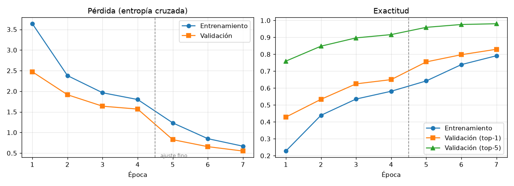
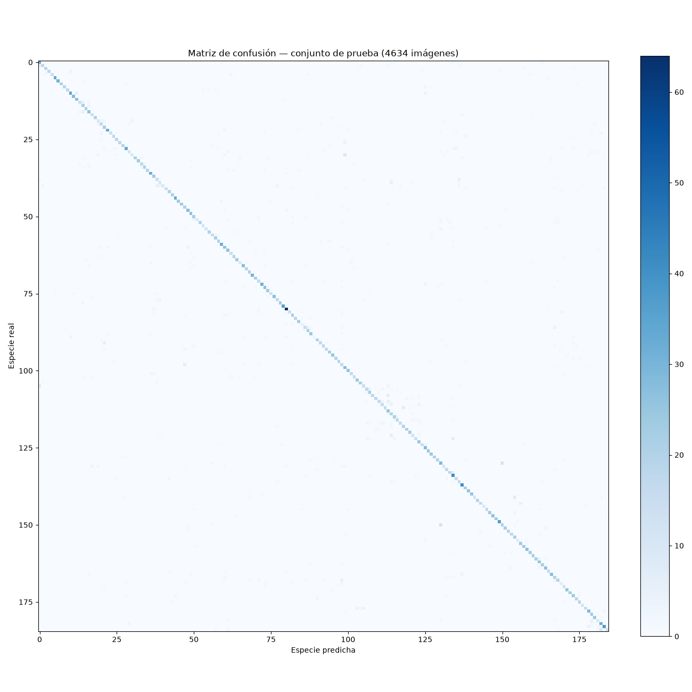

# 🌿 Reconocimiento de Hojas de Plantas con una Red Neuronal Convolucional

**Proyecto final de Machine Learning** — Clasificación de imágenes de hojas con una
RNA convolucional ejecutada directamente en el navegador, con captura desde la cámara
del celular.

> **Entregable:** [`web/index.html`](web/index.html) — un único archivo HTML autocontenido
> que implementa la red neuronal, incluye sus pesos entrenados y permite tomar una foto
> con el celular para identificar la especie de la hoja. No necesita servidor:
> la inferencia ocurre en el dispositivo.

---

## 1. Resumen

| Aspecto | Detalle |
|---|---|
| Tarea | Clasificación de imágenes de hojas (185 especies de árboles) |
| Base de datos | **Leafsnap** (Columbia Univ. · Univ. de Maryland · Smithsonian) |
| Volumen | 30 866 imágenes (23 147 de laboratorio + 7 719 de campo con celular) |
| Modelo | **MobileNetV2** (preentrenada en ImageNet) + cabeza de clasificación |
| Entrenamiento | PyTorch en CPU — transfer learning en 2 fases |
| Despliegue | Un archivo HTML con **TensorFlow.js** (inferencia local, sin servidor) |
| Entrada de usuario | Cámara en vivo, cámara del sistema o imagen de la galería |
| Exactitud (prueba) | top-1 **82,4 %** · top-5 **98,1 %** |
| Exactitud con fotos de campo | top-1 **72,5 %** · top-5 96,9 % |

La actividad pedía *al menos cincuenta tipos de hojas*; este proyecto reconoce
**185 tipos**, y el trabajo “de feria” está implementado: **se toma la foto
directamente con el celular y la red convolucional realiza la predicción en el momento**.

---

## 2. La base de datos: Leafsnap

No existía un dataset local con imágenes de hojas, por lo que se buscó y descargó una
base de datos pública de referencia en botánica computacional:

- **Leafsnap** (Kumar *et al.*, ECCV 2012): guía de campo electrónica de las
  universidades de Columbia y de Maryland junto al Instituto Smithsonian.
- **185 especies** de árboles del noreste de Estados Unidos.
- **30 866 fotos** en dos fuentes:
  - *lab* (23 147): hojas prensadas de la colección del Smithsonian, digitalizadas con
    iluminación controlada (fondo claro).
  - *field* (7 719): fotos “normales” tomadas con **teléfonos móviles** en exteriores,
    con desenfoques, sombras y ruido variables — justo el caso de uso de este proyecto.
- Cada especie tiene entre 56 y 448 imágenes (todas superan las 50).

**Obtención:** el sitio original retiró sus archivos de descarga, por lo que el dataset
se recuperó del archivo histórico del *Wayback Machine*:

```
https://web.archive.org/web/20160322210241id_/http://leafsnap.com/static/dataset/leafsnap-dataset.tar
```

> **Cita obligatoria del dataset:**
> N. Kumar, P. N. Belhumeur, A. Biswas, D. W. Jacobs, W. J. Kress, I. C. Lopez,
> J. V. B. Soares. *«Leafsnap: A Computer Vision System for Automatic Plant Species
> Identification»*. Proceedings of the 12th European Conference on Computer Vision
> (ECCV), 2012.

---

## 3. Metodología

### 3.1 Preprocesamiento (`entrenamiento/01_preparar_datos.py`)

1. Extracción del dataset y lectura de su índice oficial (`leafsnap-dataset-images.txt`).
2. Redimensionado de cada imagen **conservando la proporción** a 256×256 px, completando
   el cuadrado con gris neutro (*letterbox*). Así la silueta de la hoja —un rasgo
   botánico clave— no se deforma.
3. División **estratificada** por especie y fuente: 70 % entrenamiento /
   15 % validación / 15 % prueba (el conjunto de prueba nunca se ve durante el
   entrenamiento).

### 3.2 Arquitectura de la red convolucional

```
Entrada 224×224×3
   │
   ├─ Conv 3×3 (32 filtros) + BatchNorm + ReLU6
   │
   ├─ 17 bloques residuales invertidos (MobileNetV2)
   │     expansión 1×1  →  convolución en profundidad 3×3  →  proyección 1×1  →  suma residual
   │
   ├─ Conv 1×1 (1280 filtros) + BatchNorm + ReLU6
   │
   ├─ Promedio global (GAP)
   │
   └─ Capa densa 185 + Softmax  →  probabilidad de cada especie
```

Se eligió **MobileNetV2** por tres motivos: (1) sus pesos preentrenados en ImageNet ya
saben detectar bordes y texturas; (2) es ligera y rápida en un celular; (3) es una
arquitectura convolucional profunda estándar. Total de parámetros: **2 460 857**.

### 3.3 Entrenamiento (`entrenamiento/02_entrenar.py`) — *transfer learning*

| | Fase 1 · cabeza | Fase 2 · ajuste fino |
|---|---|---|
| Capas entrenables | solo la capa densa final | últimos 4 bloques convolucionales + cabeza |
| Épocas | 4 | 3 |
| Tasa de aprendizaje | 1e-3 (AdamW) | 1e-4 (AdamW) |
| Programador | coseno | coseno |
| Regularización | decaimiento de peso 1e-4, dropout 0.2 | ídem |

**Aumentación de datos** (clave para generalizar a fotos con celular):
recortes aleatorios con zoom, volteo horizontal, rotaciones (hasta ±12° siempre y
rotaciones grandes ocasionales, para ser robusto a la orientación de la hoja al
fotografiarla) y variaciones de color/brillo/contraste que simulan distintas luces.

La normalización de entrada es la de ImageNet (media `[0.485, 0.456, 0.406]`,
desviación `[0.229, 0.224, 0.225]`), reproducida exactamente en el navegador.

---

## 4. Resultados

*(conjunto de prueba — imágenes nunca vistas durante el entrenamiento)*

| Métrica | Valor |
|---|---|
| Exactitud top-1 (global) | **82,4 %** |
| Exactitud top-5 (global) | **98,1 %** |
| Exactitud top-1 — fotos de laboratorio | **85,7 %** |
| Exactitud top-1 — fotos de campo (celular) | **72,5 %** |
| Imágenes de prueba | 4 634 |

Curvas de entrenamiento:



Matriz de confusión (185×185):



Los errores se concentran en especies morfológicamente casi idénticas (por ejemplo
entre pinos o entre robles), algo esperable incluso para un botánico.

---

## 5. Despliegue en el navegador (`web/`)

El modelo entrenado en PyTorch se exporta a un formato sencillo
(`entrenamiento/03_exportar_js.py`) y la red se **implementa capa por capa en
JavaScript** con TensorFlow.js (`web/red-neuronal.js`): convolución, convolución en
profundidad, normalización por lotes, ReLU6, conexión residual, promedio global,
capa densa y softmax.

Para que el entregable sea **un solo archivo HTML** los pesos se incrustan en base64
comprimidos en **coma flotante de 16 bits**. El formato se eligió comparando la
exactitud de cada compresión sobre el conjunto de prueba
(`entrenamiento/07_verificar_cuantizacion.py`):

| Formato de los pesos | Tamaño aprox. | Exactitud top-1 |
|---|---|---|
| coma flotante de 32 bits (original) | ~10 MB | 82,4 % |
| **coma flotante de 16 bits (elegido)** | **~5 MB** | **82,4 %** (sin pérdida) |
| enteros de 8 bits | ~2,7 MB | 77,7 % (pierde 4,7 puntos) |

La página incluye además:

- 📹 **Cámara en vivo** con marco guía (`getUserMedia`) y botón de captura.
- 📸 Acceso directo a la cámara del sistema (`<input capture>`), ideal en celulares.
- 🖼️ Subida de imágenes de la galería.
- 🔝 Resultado con las **5 especies más probables**, porcentajes y ficha con nombre
  común (español/inglés), familia botánica y género (datos de Wikidata/Wikipedia).
- ⚠️ Aviso de *confianza baja* cuando la foto no es concluyente.
- 🌲 Listado buscable de las 185 especies.
- 🧠 Sección explicativa de las redes convolucionales y del *transfer learning*.

**Verificación de la implementación:** `web/verificacion.html` compara numéricamente la
salida de la CNN en JavaScript contra la del modelo de PyTorch con una entrada idéntica
(diferencia máxima tolerada 0.02). Genera el archivo con
`python entrenamiento/06_generar_html.py` y ábrelo desde un servidor local.

---

## 6. Cómo usar la aplicación

1. Publica o abre `web/index.html` (ver sección siguiente).
2. Pulsa **«📹 Cámara en vivo»** (o «Tomar foto» en el celular).
3. Encuadra la hoja dentro del marco —buena luz y fondo que contraste— y captura.
4. La red analiza la imagen en tu dispositivo y muestra las 5 especies más probables
   con su ficha informativa.

> ⚠️ Los navegadores solo permiten usar la cámara en páginas **HTTPS** o en
> `localhost`. Al publicar en GitHub Pages / Netlify / Vercel se obtiene HTTPS
> automáticamente. Para probar en local: `python -m http.server 8000` dentro de `web/`
> y abre `http://localhost:8000/index.html`.

---

## 7. Cómo reproducir el proyecto

```bash
pip install torch torchvision pillow numpy pandas matplotlib

# 1. Descargar el dataset (977 MB) y prepararlo
curl -L -o datos/leafsnap-dataset.tar "https://web.archive.org/web/20160322210241id_/http://leafsnap.com/static/dataset/leafsnap-dataset.tar"
python entrenamiento/01_preparar_datos.py

# 2. Entrenar la red (unas horas en CPU)
python entrenamiento/02_entrenar.py

# 3. Evaluar y generar gráficas
python entrenamiento/05_evaluar.py

# 4. Exportar los pesos para el navegador y verificar la cuantización
python entrenamiento/03_exportar_js.py --c i8
python entrenamiento/07_verificar_cuantizacion.py

# 5. Nombres comunes de las especies (Wikidata)
python entrenamiento/04_metadatos_especies.py

# 6. Generar el HTML final autocontenido
python entrenamiento/06_generar_html.py
```

---

## 8. Cómo publicar el HTML (el «enlace» de la actividad)

**Opción A — Railway (host elegido):**

El repositorio ya incluye todo lo necesario para Railway: `railway.json` (configuración
de build), `package.json` (arranque con `npm start`) y `server.js` (servidor estándar de
Node que publica la carpeta `web/`).

1. Sube este repositorio a GitHub.
2. En [railway.app](https://railway.app) → *New Project → Deploy from GitHub repo* y
   selecciona el repositorio (o ejecuta `railway up` con la CLI).
3. Railway detecta la configuración y despliega automáticamente.
4. En *Settings → Networking → Generate Domain* obtienes tu enlace
   `https://xxxx.up.railway.app` — al ser **HTTPS, la cámara del celular funciona
   directamente**.

**Opción B — GitHub Pages:** sube la carpeta `web/` y activa *Settings → Pages*.

**Opción C — Netlify Drop:** arrastra `web/index.html` en
<https://app.netlify.com/drop> y obtienes el enlace al instante.

En todas ellas la página se sirve por **HTTPS**, por lo que la cámara del celular
funciona sin problemas.

---

## 9. Estructura del proyecto

```
├── README.md                        ← este documento
├── datos/
│   ├── leafsnap-dataset.tar         ← dataset original (Wayback Machine)
│   ├── leafsnap-dataset-images.txt  ← índice oficial (30 866 imágenes)
│   ├── metadatos_imagenes.csv       ← especie, fuente y división de cada imagen
│   └── procesado/                   ← imágenes 256×256 en train/val/test
├── entrenamiento/
│   ├── 01_preparar_datos.py         ← extracción, redimensionado y división
│   ├── 02_entrenar.py               ← entrenamiento (PyTorch, transfer learning)
│   ├── 03_exportar_js.py            ← exportación de pesos para el navegador
│   ├── 04_metadatos_especies.py     ← nombres comunes (Wikidata/Wikipedia)
│   ├── 05_evaluar.py                ← métricas, curvas y matriz de confusión
│   ├── 06_generar_html.py           ← genera web/index.html autocontenido
│   ├── 07_verificar_cuantizacion.py ← f16 / int8 vs precisión original
│   ├── clases.json                  ← las 185 especies
│   └── resultados/                  ← modelo .pth, métricas y gráficas
└── web/
    ├── index.html                   ← ★ ENTREGABLE: archivo único autocontenido
    ├── index-ligero.html            ← versión ligera (pesos en archivos aparte)
    ├── red-neuronal.js              ← implementación de la CNN en JavaScript
    ├── modelo/                      ← manifiesto + pesos + caso de verificación
    ├── verificacion.html            ← comprobación JS vs PyTorch
    └── metadatos_especies.json      ← fichas de las 185 especies
```

---

## 10. Limitaciones y trabajo futuro

- **Conjunto de clases cerrado:** el modelo siempre elige una de las 185 especies del
  dataset. Fotografiar una planta ajena al dataset produce una respuesta forzada; la
  aplicación lo mitiga mostrando el porcentaje de confianza y un aviso cuando es bajo.
- **Fondo y encuadre:** las fotos de laboratorio tienen fondo claro; para uso general
  conviene una etapa de segmentación de la hoja.
- **Mejoras posibles:** más datos de campo, aumento de datos con fondos aleatorios,
  poda de la red (*distilación*) y cuantización INT8 con calibración para acelerar aún
  más la inferencia en móviles.

---

## 11. Referencias

1. Kumar, N. *et al.* «Leafsnap: A Computer Vision System for Automatic Plant Species
   Identification». *ECCV*, 2012.
2. Sandler, M. *et al.* «MobileNetV2: Inverted Residuals and Linear Bottlenecks».
   *CVPR*, 2018.
3. Howard, A. G. *et al.* «MobileNets: Efficient Convolutional Neural Networks for
   Mobile Vision Applications». *arXiv:1704.04861*, 2017.
4. Deng, J. *et al.* «ImageNet: A Large-Scale Hierarchical Image Database». *CVPR*, 2009.
5. Paszke, A. *et al.* «PyTorch: An Imperative Style, High-Performance Deep Learning
   Library». *NeurIPS*, 2019.
6. Smilkov, D. *et al.* «TensorFlow.js: Machine Learning for JavaScript and the Web».
   *arXiv:1808.03314*, 2018.
